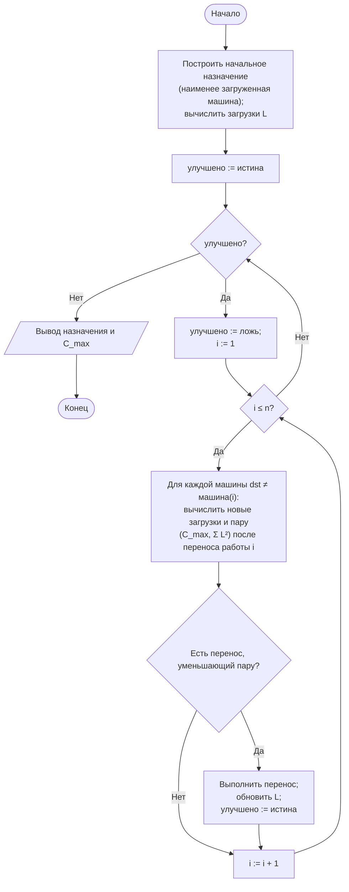

<!-- титул-начало -->
**МИНИСТЕРСТВО НАУКИ И ВЫСШЕГО ОБРАЗОВАНИЯ РОССИЙСКОЙ ФЕДЕРАЦИИ**

Государственный Университет Управления

Кафедра: Институт Информационных Систем

# Лабораторная работа № 12

## Точные и эвристические алгоритмы для NP-трудных задач: расписание на трёх машинах

**Дисциплина:** Теория алгоритмов

**Направление подготовки:** 38.03.05 «Бизнес-информатика»

**Язык реализации:** Python 3.10+

**Вариант:** 14

**Выполнил:** студент группы БИ 2-1 Лапшенков Григорий Витальевич

**Проверил:** [должность, ФИО преподавателя]

[Город], 2026
<!-- титул-конец -->


---

## 1. Цель работы и задание варианта

### 1.1. Цель работы

Изучить различие между задачами, решаемыми за полиномиальное время, и труднорешаемыми задачами, определить пределы применимости точного метода полного перебора и сопоставить его с конструктивной эвристикой и методом локального улучшения.

### 1.2. Задание варианта 14

**Таблица 1. Исходные данные варианта**

| Параметр | Значение |
|---|---|
| Задача | расписание на 3 машинах |
| Точный метод | полный перебор |
| Конструктивная эвристика | наименее загруженная машина |
| Локальный поиск | перенос работы |
| Размерности | 9…15 (сравнение с оптимумом), 200 (эвристики) |
| Дополнительное задание | М7 — прикладная постановка и экономический эффект перехода от эвристики к улучшенному решению |

**Данные.** Длительности работ — случайные целые числа от 1 до 50 (генератор с фиксированным зерном); машины одинаковы, работы неделимы и не прерываются. Целевая функция — время завершения всех работ $C_{\max}$ (максимальная загрузка машины), минимизируется.

---

## 2. Постановка задачи и обоснование NP-трудности

### 2.1. Постановка

Даны $n$ работ с длительностями $p_1, \ldots, p_n$ и три одинаковые машины. Требуется распределить работы по машинам (каждая работа — на одну машину) так, чтобы минимизировать $C_{\max} = \max_{k} L_k$, где $L_k$ — суммарная длительность работ на машине $k$. Допустимых назначений $3^n$.

Простые границы оптимума: $C^* \ge \max\bigl(\max_i p_i,\ \lceil \tfrac13 \sum p_i \rceil\bigr) = LB$ — нижняя граница, по которой оценивается качество решений при больших $n$.

### 2.2. NP-трудность

Задача содержит как частный случай задачу о разбиении (PARTITION): даны числа $a_1, \ldots, a_k$ с суммой $2S$; можно ли разбить их на две части с суммой $S$ каждая? Построим по ним задачу на трёх машинах из $k + 1$ работ: работы $a_i$ и ещё одна работа длительностью $S$. Суммарная длительность равна $3S$, поэтому $C_{\max} \le S$ достижимо тогда и только тогда, когда все три машины загружены ровно на $S$. Работа длительностью $S$ целиком занимает одну машину, а оставшиеся работы $a_i$ распределяются по двум другим машинам по $S$ — то есть именно тогда, когда разбиение существует. Поскольку PARTITION NP-полна (Карп, 1972), решение вопроса «$C_{\max} \le S$?» для трёх машин тоже NP-полно, а оптимизационная задача — NP-трудна. Задача NP-трудна в слабом смысле: существует псевдополиномиальный алгоритм динамического программирования (раздел 3.4), эффективный при малых длительностях.

---

## 3. Описание алгоритмов

### 3.1. Полный перебор (точный метод)

Рекурсивно перебираются все назначения работ на машины; для каждого полного назначения вычисляется $C_{\max}$, запоминается наименьшее. Так как машины одинаковы, первая работа закрепляется за машиной 0: рассматривается $3^{n-1}$ назначений. Трудоёмкость $\Theta(3^n)$.

### 3.2. Конструктивная эвристика «наименее загруженная машина»

Работы просматриваются в заданном порядке; каждая очередная назначается на машину с наименьшей текущей загрузкой. Трудоёмкость $\Theta(nm)$ при $m$ машинах. Гарантия качества (Грэм, 1966): $C_{\max} \le \bigl(2 - \tfrac1m\bigr) C^* = \tfrac53 C^*$ при $m = 3$ для любого порядка работ. Ошибка метода систематическая: решение принимается «жадно» и не учитывает, что поздняя длинная работа может создать дисбаланс.

### 3.3. Локальный поиск «перенос работы»

**Окрестность** решения — все назначения, получаемые переносом одной работы на другую машину ($n(m-1) = 2n$ соседей). Перенос принимается, если он уменьшает пару (время завершения $C_{\max}$, сумма квадратов загрузок $\sum L_k^2$) в лексикографическом порядке: сначала улучшается $C_{\max}$, при равном $C_{\max}$ — выравниваются загрузки. Пара строго убывает при каждом переносе на конечном множестве назначений, поэтому алгоритм завершается; результат — локальный оптимум, в котором ни один перенос не улучшает решение. Начальное решение строится эвристикой 3.2. Трудоёмкость одного прохода $\Theta(nm^2)$, то есть $\Theta(n)$ при $m = 3$.

### 3.4. Динамическое программирование (для проверки)

Для проверки перебора и для размерностей 14 и 15, где перебор для 30 наборов занял бы слишком много времени, оптимум находится независимо: множество состояний — упорядоченные тройки загрузок $(L_1, L_2, L_3)$; для каждой работы добавляются тройки с прибавлением длительности к каждой из загрузок, состояния с загрузкой выше верхней оценки отбрасываются. Число состояний ограничено $O(S^2)$ ($S$ — сумма длительностей), что даёт псевдополиномиальную трудоёмкость. На размерностях 9…13 результаты перебора и ДП сверены на каждом из 30 наборов (проверки `assert` в программе).

---

## 4. Блок-схема локального поиска



---

## 5. Листинг программы

Программа содержит генератор работ, полный перебор, ДП для проверки, обе эвристики (и сортировку по убыванию для сравнения в задании М7), замеры, серию наборов, имитацию рабочих дней и построение графиков.

```python
"""
Лабораторная работа № 12. Вариант 14.
Составление расписания на 3 машинах: минимизация времени завершения всех работ.
Точный метод — полный перебор; конструктивная эвристика — «наименее загруженная
машина»; локальный поиск — перенос работы. Размерности: 9…15 (точно), 200 (эвристики).
Дополнительное задание М7: прикладная постановка и экономический эффект.
"""
import gc
import json
import math
import random
import statistics
import time

M = 3                      # число машин
LO, HI = 1, 50             # длительности работ — случайные целые из [1; 50]


# ------------------------------------------------------------ вспомогательное
def random_jobs(n, rng):
    return [rng.randint(LO, HI) for _ in range(n)]


def loads_of(jobs, assign, m=M):
    loads = [0] * m
    for p, k in zip(jobs, assign):
        loads[k] += p
    return loads


def lower_bound(jobs, m=M):
    """Нижняя граница оптимума: max(самая длинная работа, ⌈сумма / m⌉)."""
    return max(max(jobs), math.ceil(sum(jobs) / m))


# ------------------------------------------------------------ точные методы
def brute_force(jobs, m=M):
    """Полный перебор: все назначения работ на m машин. Первая работа фиксируется на
    машине 0 (машины одинаковы) — рассматривается m^(n−1) назначений.
    Возвращает (оптимальное время завершения, число рассмотренных назначений)."""
    n = len(jobs)
    best = [sum(jobs)]
    count = [0]
    loads = [0] * m

    def rec(i):
        if i == n:
            count[0] += 1
            mx = max(loads)
            if mx < best[0]:
                best[0] = mx
            return
        p = jobs[i]
        for k in range(m):
            loads[k] += p
            rec(i + 1)
            loads[k] -= p

    loads[0] = jobs[0]
    rec(1)
    return best[0], count[0]


def dp_optimum(jobs, upper):
    """Независимое точное решение (псевдополиномиальное ДП по множеству состояний —
    упорядоченных троек загрузок). Состояния с загрузкой выше верхней оценки отбрасываются.
    Используется для проверки перебора и для размерностей, где перебор слишком долог."""
    states = {(0, 0, 0)}
    for p in jobs:
        new = set()
        for a, b, c in states:
            for t in ((a + p, b, c), (a, b + p, c), (a, b, c + p)):
                if t[0] <= upper and t[1] <= upper and t[2] <= upper:
                    new.add(tuple(sorted(t, reverse=True)))
        states = new
    return min(s[0] for s in states)


# ---------------------------------------------------------------- эвристики
def least_loaded(jobs, m=M):
    """Конструктивная эвристика: каждая очередная работа (в заданном порядке)
    назначается на наименее загруженную машину. Θ(n·m)."""
    loads = [0] * m
    assign = []
    for p in jobs:
        k = loads.index(min(loads))
        assign.append(k)
        loads[k] += p
    return assign


def lpt(jobs, m=M):
    """Для сравнения: та же эвристика, но работы предварительно упорядочены по убыванию."""
    order = sorted(range(len(jobs)), key=lambda i: -jobs[i])
    loads = [0] * m
    assign = [0] * len(jobs)
    for i in order:
        k = loads.index(min(loads))
        assign[i] = k
        loads[k] += jobs[i]
    return assign


def local_search_move(jobs, assign, m=M):
    """Локальный поиск с окрестностью «перенос одной работы на другую машину».
    Перенос принимается, если он уменьшает пару (время завершения, сумма квадратов
    загрузок) в лексикографическом порядке — это гарантирует завершение.
    Возвращает (новое назначение, число проходов, число принятых переносов)."""
    assign = list(assign)
    loads = loads_of(jobs, assign, m)
    improved, passes, moves = True, 0, 0
    while improved:
        improved = False
        passes += 1
        for i, p in enumerate(jobs):
            src = assign[i]
            for dst in range(m):
                if dst == src:
                    continue
                cur_max = max(loads)
                new_src, new_dst = loads[src] - p, loads[dst] + p
                rest = max((loads[k] for k in range(m) if k != src and k != dst), default=0)
                new_max = max(new_src, new_dst, rest)
                old_sq = loads[src] ** 2 + loads[dst] ** 2
                new_sq = new_src ** 2 + new_dst ** 2
                if new_max < cur_max or (new_max == cur_max and new_sq < old_sq):
                    loads[src], loads[dst] = new_src, new_dst
                    assign[i] = dst
                    improved = True
                    moves += 1
                    break
    return assign, passes, moves


def random_assignment(jobs, rng, m=M):
    return [rng.randrange(m) for _ in jobs]


def makespan(jobs, assign, m=M):
    return max(loads_of(jobs, assign, m))


# ---------------------------------------------------------------- замеры
def timed(func, *args, repeats=3):
    times = []
    for _ in range(repeats):
        gc.collect()
        t0 = time.perf_counter()
        result = func(*args)
        times.append(time.perf_counter() - t0)
    return statistics.median(times), result


def make_plots(res):
    import matplotlib
    matplotlib.use("Agg")
    import matplotlib.pyplot as plt

    ex = res["exact"]
    ns = [r["n"] for r in ex]
    plt.figure(figsize=(6.8, 4.4))
    plt.semilogy(ns, [r["t"] for r in ex], "o-", label="время полного перебора")
    base = ex[0]["t"] / 3 ** (ex[0]["n"] - 1)
    plt.semilogy(ns, [base * 3 ** (n - 1) for n in ns], "k--", lw=1, label=r"$c \cdot 3^{n-1}$")
    plt.axhline(10, color="gray", ls=":", label="10 с")
    plt.xlabel("число работ n"); plt.ylabel("время, с (логарифмическая шкала)")
    plt.title("Рост времени точного метода"); plt.grid(True, which="both", alpha=.3); plt.legend()
    plt.tight_layout(); plt.savefig("img/lr12_exact.png", dpi=170); plt.close()

    dv = res["series"]
    plt.figure(figsize=(6.8, 4.2))
    ns2 = [r["n"] for r in dv]
    x = range(len(ns2))
    plt.bar([i - 0.2 for i in x], [r["dev_ll"] for r in dv], 0.4, label="наименее загруженная машина")
    plt.bar([i + 0.2 for i in x], [r["dev_ls"] for r in dv], 0.4, label="+ перенос работы")
    plt.xticks(list(x), ns2); plt.xlabel("число работ n"); plt.ylabel("среднее отклонение от оптимума, %")
    plt.title("Качество эвристик (30 наборов на каждое n)"); plt.legend(); plt.grid(True, axis="y", alpha=.3)
    plt.tight_layout(); plt.savefig("img/lr12_dev.png", dpi=170); plt.close()

    ap = res["app"]
    plt.figure(figsize=(6.8, 4.2))
    plt.boxplot([ap["days"]["ll"], ap["days"]["ls"], ap["days"]["lpt"]],
                tick_labels=["наименее\nзагруженная", "+ перенос\nработы", "сортировка\nпо убыванию"], showmeans=True)
    plt.ylabel("время завершения смены, мин"); plt.title("250 рабочих дней, 200 заказов в день")
    plt.grid(True, axis="y", alpha=.3); plt.tight_layout(); plt.savefig("img/lr12_app.png", dpi=170); plt.close()


# ------------------------------------------------------------------- main
if __name__ == "__main__":
    res = {}
    rng = random.Random(14)

    # --- 1. Рост времени полного перебора
    res["exact"] = []
    print(f"{'n':>3}{'назначений':>14}{'время, с':>11}")
    n = 8
    while True:
        n += 1
        jobs = random_jobs(n, rng)
        t, (opt, cnt) = timed(brute_force, jobs, repeats=1)
        assert cnt == 3 ** (n - 1)
        ll = makespan(jobs, least_loaded(jobs))
        assert opt == dp_optimum(jobs, ll), "перебор и ДП расходятся"
        res["exact"].append({"n": n, "count": cnt, "t": t, "opt": opt})
        print(f"{n:>3}{cnt:>14}{t:>11.3f}", flush=True)
        if t > 10:
            res["limit"] = n
            break

    # --- 2. Отклонение эвристик от оптимума, 30 наборов на каждое n = 9…15
    res["series"] = []
    print(f"\n{'n':>3}{'LL, %':>9}{'LL+move, %':>12}{'доля опт. LL':>14}{'доля опт. LL+move':>19}{'источник оптимума':>20}")
    for n in range(9, 16):
        d_ll, d_ls, hit_ll, hit_ls = [], [], 0, 0
        source = "перебор" if n <= 13 else "ДП"
        for _ in range(30):
            jobs = random_jobs(n, rng)
            a1 = least_loaded(jobs)
            c1 = makespan(jobs, a1)
            a2, _, _ = local_search_move(jobs, a1)
            c2 = makespan(jobs, a2)
            opt = brute_force(jobs)[0] if n <= 13 else dp_optimum(jobs, c1)
            if n <= 13:
                assert opt == dp_optimum(jobs, c1)          # перекрёстная проверка
            assert opt <= c2 <= c1
            d_ll.append((c1 - opt) / opt * 100)
            d_ls.append((c2 - opt) / opt * 100)
            hit_ll += c1 == opt
            hit_ls += c2 == opt
        res["series"].append({"n": n, "dev_ll": statistics.mean(d_ll), "dev_ls": statistics.mean(d_ls),
                              "max_ll": max(d_ll), "max_ls": max(d_ls),
                              "hit_ll": hit_ll / 30, "hit_ls": hit_ls / 30, "source": source})
        r = res["series"][-1]
        print(f"{n:>3}{r['dev_ll']:>9.2f}{r['dev_ls']:>12.2f}{r['hit_ll'] * 100:>13.0f}%{r['hit_ls'] * 100:>18.0f}%{source:>20}", flush=True)

    # --- 3. Большая размерность n = 200
    N = 200
    jobs = random_jobs(N, random.Random(200))
    lb = lower_bound(jobs)
    res["large"] = {"n": N, "sum": sum(jobs), "lb": lb}
    rnd = random_assignment(jobs, random.Random(1))
    t1, a1 = timed(least_loaded, jobs, repeats=20)
    t2, (a2, passes, moves) = timed(local_search_move, jobs, a1, repeats=20)
    res["large"]["rows"] = {
        "random": {"c": makespan(jobs, rnd), "t": None},
        "ll": {"c": makespan(jobs, a1), "t": t1},
        "ls": {"c": makespan(jobs, a2), "t": t2, "passes": passes, "moves": moves}}
    print(res["large"])
    # усреднение по 30 наборам
    agg = {"random": [], "ll": [], "ls": []}
    r2 = random.Random(77)
    for _ in range(30):
        jb = random_jobs(N, r2)
        b = lower_bound(jb)
        x1 = least_loaded(jb)
        x2, _, _ = local_search_move(jb, x1)
        agg["random"].append((makespan(jb, random_assignment(jb, r2)) - b) / b * 100)
        agg["ll"].append((makespan(jb, x1) - b) / b * 100)
        agg["ls"].append((makespan(jb, x2) - b) / b * 100)
    res["large"]["avg_gap"] = {k: statistics.mean(v) for k, v in agg.items()}
    print(res["large"]["avg_gap"])

    # --- 4. М7: заказы на трёх упаковочных линиях, 250 рабочих дней
    r3 = random.Random(250)
    days = {"ll": [], "ls": [], "lpt": [], "lb": []}
    for _ in range(250):
        jb = random_jobs(200, r3)
        x1 = least_loaded(jb)
        x2, _, _ = local_search_move(jb, x1)
        days["ll"].append(makespan(jb, x1))
        days["ls"].append(makespan(jb, x2))
        days["lpt"].append(makespan(jb, lpt(jb)))
        days["lb"].append(lower_bound(jb))
    res["app"] = {"days": days, "mean": {k: statistics.mean(v) for k, v in days.items()}}
    print(res["app"]["mean"])

    with open("res/lr12.json", "w", encoding="utf-8") as f:
        json.dump(res, f, ensure_ascii=False)
    make_plots(res)
```

---

## 6. Рост времени точного метода

| Параметр | Значение |
|---|---|
| Операционная система | Linux 6.18 (x86_64), виртуальная машина |
| Процессор | Intel Xeon, 2,10 ГГц, 1 виртуальное ядро |
| Оперативная память | 4 ГБ |
| Интерпретатор | CPython 3.12.3 |
| Способ замера времени | `time.perf_counter()`, перед каждым прогоном вызывается `gc.collect()` |

Для каждого $n$ генерируется один набор длительностей; каждое решение перебора сверено с ДП. Время измерялось одним прогоном.

**Таблица 2. Время полного перебора**

| $n$ | Назначений $3^{n-1}$ | Время, с | Рост времени к предыдущему $n$ | Оптимум $C_{\max}$ |
|---:|---:|---:|---:|---:|
| 9 | 6 561 | 0,003 | — | 100 |
| 10 | 19 683 | 0,010 | 2,92 | 94 |
| 11 | 59 049 | 0,029 | 2,98 | 96 |
| 12 | 177 147 | 0,087 | 3,01 | 88 |
| 13 | 531 441 | 0,263 | 3,02 | 103 |
| 14 | 1 594 323 | 0,787 | 2,99 | 141 |
| 15 | 4 782 969 | 2,267 | 2,88 | 90 |
| 16 | 14 348 907 | 5,403 | 2,38 | 147 |
| 17 | 43 046 721 | 15,763 | 2,92 | 146 |

Число назначений равно $3^{n-1}$ (сверено со счётчиком). При увеличении $n$ на единицу время растёт примерно в 3 раза (от 2,4 до 3,3 по отдельным замерам), как и ожидается для $\Theta(3^n)$ (шум замеров для малых времён). **Предельное значение:** при $n = 16$ перебор занял 5,4 с, при $n = 17$ — 15,8 с > 10 с; предельным для интерактивной работы следует считать $n = 16$.

![Рис. 1. Время полного перебора (логарифмическая шкала) и теоретическая кривая $c \cdot 3^{n-1}$]()

**Экстраполяция** по среднему времени одного назначения при $n = 17$ (0,37 мкс):

**Таблица 3. Оценка времени полного перебора при больших $n$**

| $n$ | Назначений $3^{n-1}$ | Оценка времени (экстраполяция) |
|---:|---:|---:|
| 20 | $\approx 1{,}16 \cdot 10^{9}$ | 7 мин |
| 25 | $\approx 2{,}82 \cdot 10^{11}$ | 29 ч |
| 30 | $\approx 6{,}86 \cdot 10^{13}$ | 291 сут. |
| 40 | $\approx 4{,}05 \cdot 10^{18}$ | 47 058 лет |

Ускорение вычислительной техники не спасает: компьютер в 10 раз быстрее позволит решать задачи лишь на $\log_3 10 \approx 2,1$ работы больше. Для $n = 200$ имеется около $10^{95}$ назначений — перебор невозможен.

---

## 7. Отклонение эвристик от оптимума на малых размерностях

Для каждого $n = 9 \ldots 15$ сгенерировано 30 наборов; оптимум найден полным перебором ($n \le 13$) или ДП ($n = 14, 15$; для $n \le 13$ оба метода совпали). Отклонение $= (C_{\max} - C^*) / C^* \cdot 100\,\%$.

**Таблица 4. Отклонение эвристик от оптимума (30 наборов на каждое $n$)**

| $n$ | Оптимум найден | Эвристика 1: среднее отклонение, % | макс., % | Доля оптимальных | Эвристика 1 + перенос: среднее, % | макс., % | Доля оптимальных |
|---:|---|---:|---:|---:|---:|---:|---:|
| 9 | перебор | 14,43 | 34,0 | 0 % | 5,46 | 15,4 | 13 % |
| 10 | перебор | 11,23 | 28,1 | 3 % | 5,70 | 21,0 | 7 % |
| 11 | перебор | 11,93 | 27,1 | 0 % | 5,36 | 15,1 | 3 % |
| 12 | перебор | 13,20 | 34,8 | 0 % | 6,15 | 32,6 | 7 % |
| 13 | перебор | 12,44 | 23,6 | 0 % | 4,71 | 15,1 | 7 % |
| 14 | ДП | 9,16 | 22,4 | 0 % | 3,55 | 9,4 | 3 % |
| 15 | ДП | 9,94 | 20,4 | 0 % | 3,07 | 7,5 | 0 % |

![Рис. 2. Среднее отклонение эвристик от оптимума]()

Конструктивная эвристика даёт в среднем 9,2–14,4 % сверх оптимума (в наихудших наборах — до 35 %), добавление переноса работы снижает среднее отклонение в 2,5–3,2 раза — до 3,1–6,1 %. Оптимальное решение достигается редко: конструктивной эвристикой почти никогда (0–3 %), локальным поиском — в 0–13 % наборов. Локальный оптимум в окрестности переноса не обязательно глобален: чтобы выйти из него, нужен, например, обмен двух работ.

---

## 8. Результаты на большой размерности ($n = 200$)

Оптимум неизвестен (перебор невозможен), поэтому качество оценивается относительно нижней границы $LB$. Для одного набора: сумма длительностей 5 001, $LB = 1667$.

**Таблица 5. Один набор из 200 работ**

| Метод | Время завершения $C_{\max}$ | Отклонение от нижней границы, % | Время работы, мс |
|---|---:|---:|---:|
| Случайное назначение | 1778 | 6,66 | — |
| Наименее загруженная машина | 1675 | 0,48 | 0,051 |
| Наименее загруженная машина + перенос работы | 1667 | 0,00 | 0,901 |

Локальный поиск (2 прохода, 6 переносов) довёл $C_{\max}$ до 1667, то есть **до нижней границы**: все три машины загружены поровну (сумма 5 001 делится на 3), и это решение **доказуемо оптимально** ($LB \le C^* \le C_{\max} = LB$). Конструктивная эвристика дала 1675 — на 8 единиц выше. Случайное назначение даёт 1778.

Усреднение по 30 наборам по 200 работ:

**Таблица 6. Среднее отклонение от нижней границы**

| Метод | Среднее отклонение от нижней границы, % |
|---|---:|
| Случайное назначение | 13,54 |
| Наименее загруженная машина | 0,75 |
| + перенос работы | 0,014 |

Среднее отклонение конструктивной эвристики — 0,75 %, после переноса работ — 0,014 %, то есть практически до нижней границы (а значит, до оптимума: отклонение от оптимума не превышает отклонения от $LB$).

---

## 9. Дополнительное задание М7: прикладная постановка и экономический эффект

### 9.1. Постановка

Цех упаковки заказов имеет три одинаковые линии. Ежедневно поступает 200 заказов; для каждого известна длительность упаковки (от 1 до 50 мин). Каждый заказ целиком выполняется на одной линии, прерывание не допускается. Смена заканчивается, когда завершает работу последняя линия, поэтому длина смены — это $C_{\max}$, а задача — распределить заказы по линиям так, чтобы смена закончилась как можно раньше. Это в точности задача расписания на трёх машинах.

**Текущая практика** (базовый вариант): заказы поступают в произвольном порядке, и каждый очередной направляется на наименее загруженную линию. **Улучшенное решение**: после такого распределения выполняется локальный поиск «перенос заказа».

### 9.2. Модель затрат (допущения)

- Три оператора, ставка 400 руб./ч, все остаются на смене до её окончания: стоимость минуты работы цеха $3 \cdot 400 / 60 = 20$ руб.
- 250 рабочих дней в году.
- Данные дня — случайные наборы из 200 заказов (длительности 1…50 мин); смоделированы 250 дней.
- Затратами на вычисление пренебрегаем: локальный поиск для 200 заказов занимает 0,85 мс (эвристика — 0,051 мс).

Допущения условные (ставки, число дней, равенство нагрузки линий оценены автором работы), и итоговые суммы следует пересчитать на реальных данных предприятия.

### 9.3. Результаты

**Таблица 7. Время завершения смены и экономия (250 рабочих дней)**

| Метод | Среднее время завершения смены, мин | Выигрыш против «наименее загруженной», мин/день | Экономия, руб./день | Экономия, тыс. руб./год |
|---|---:|---:|---:|---:|
| Наименее загруженная машина (текущая практика) | 1 709,44 | — | — | — |
| + перенос работы | 1 697,11 | 12,33 | 247 | 61,6 |
| Сортировка по убыванию (для сравнения) | 1 696,89 | 12,55 | 251 | 62,7 |
| Нижняя граница (теоретический минимум) | 1 696,86 | 12,58 | 252 | 62,9 |

![Рис. 3. Распределение времени завершения смены по 250 дням]()

Переход от «наименее загруженной линии» к локальному поиску сокращает смену в среднем с 1 709,4 до 1 697,1 мин (на 12,3 мин в день), что при принятых допущениях даёт 247 руб. в день и **около 61,6 тыс. руб. в год** (51 ч работы цеха, или 154 человеко-часов оплаты операторов). Для сравнения: упорядочение заказов по убыванию перед распределением даёт 12,5 мин в день (около 62,7 тыс. руб. в год) — результат практически такой же. Резерв для дальнейшей оптимизации мал: средняя смена после переноса отличается от теоретического минимума всего на 0,25 мин, то есть дополнительная экономия от более сложных методов не превысит 1,3 тыс. руб. в год.

**Таблица 8. Чувствительность годовой экономии к ставке оператора**

| Ставка оператора, руб./ч | Стоимость минуты цеха, руб. | Экономия «+ перенос работы», тыс. руб./год |
|---:|---:|---:|
| 300 | 15 | 46,2 |
| 400 | 20 | 61,6 |
| 500 | 25 | 77,0 |

Экономия пропорциональна ставке и числу рабочих дней; при любых разумных значениях она положительна, а затраты на внедрение сводятся к программной реализации: алгоритм выполняется за доли миллисекунды.

---

## 10. Выводы

1. Задача расписания на трёх машинах NP-трудна (содержит задачу о разбиении). Время полного перебора растёт как $3^{n-1}$ (примерно в 3 раза на каждую добавленную работу): при $n = 16$ — 5,4 с, при $n = 17$ — 15,8 с; для $n = 30$ оценка — около 291 сут., для $n = 200$ перебор невозможен принципиально.
2. Конструктивная эвристика «наименее загруженная машина» работает мгновенно ($\Theta(nm)$), но на малых размерностях отклоняется от оптимума в среднем на 11,8 % (до 35 % на отдельных наборах); локальный поиск «перенос работы» снижает среднее отклонение до 4,9 % за доли миллисекунды.
3. На больших размерностях ($n = 200$) связка «эвристика + локальный поиск» достигает нижней границы: отклонение в среднем 0,014 %, а на проверенном наборе решение доказуемо оптимально. Вероятное объяснение: при большом числе работ с небольшими длительностями легко выровнять загрузки, тогда как на малых размерностях ($n = 9 \ldots 15$) дискретность длительностей ограничивает точность локального поиска (причина отдельно не проверялась).
4. Для прикладной постановки (цех упаковки) переход к улучшенному решению при принятых допущениях экономит около 61,6 тыс. руб. в год при нулевых практических затратах; дальнейшие улучшения невыгодны, так как решение уже в пределах 0,25 мин от теоретического минимума.
5. **Рекомендация.** Для $n \le 12$–$14$ можно применять точные методы (перебор, ДП или метод ветвей и границ); для больших $n$ — эвристику «наименее загруженная машина» (или с предварительной сортировкой по убыванию) с последующим локальным поиском, а качество решения подтверждать нижней границей $LB$: совпадение результата с $LB$ означает доказанную оптимальность.

---

## 11. Ответы на контрольные вопросы

**1. Чем полиномиальная сложность отличается от экспоненциальной с практической точки зрения?**
Полиномиальный алгоритм при увеличении входа в $k$ раз замедляется в ограниченное число раз ($k^c$), и задачи остаются решаемыми для разумных $n$. Экспоненциальный алгоритм при добавлении одного элемента замедляется в константу раз: в нашем опыте перебор $3^{n-1}$ при $n = 15, 16, 17$ занял 2,3, 5,4 и 15,8 с; при $n = 30$ оценка — около 291 сут., при $n = 200$ — недостижимо.

**2. Почему рост быстродействия вычислительной техники не решает проблему труднорешаемых задач?**
Ускорение в $c$ раз при экспоненциальной сложности $3^n$ увеличивает допустимый размер задачи лишь на $\log_3 c$ (для $c = 10$ — примерно на 2,1 работы). Чтобы решить задачу размера 30 вместо 17, потребовалось бы ускорение в $3^{13} \approx 1{,}6 \cdot 10^6$ раз.

**3. Дайте неформальное определение классов P и NP. В чём состоит вопрос $\text{P} = \text{NP}$?**
P — задачи, решаемые за полиномиальное время; NP — задачи, для которых предложенное решение можно проверить за полиномиальное время (для расписания — сложив длительности по машинам и сравнив максимум с заданным числом). Очевидно $\text{P} \subseteq \text{NP}$; открытый вопрос — совпадают ли классы, то есть любую ли задачу, решение которой быстро проверяется, можно быстро решить.

**4. Что означает NP-полнота задачи? Чем NP-трудная задача отличается от NP-полной?**
Задача NP-полна, если она лежит в NP и к ней за полиномиальное время сводится любая задача из NP; быстрое решение хотя бы одной NP-полной задачи означало бы $\text{P} = \text{NP}$. NP-трудная задача — не легче NP-полной, но может не лежать в NP (например, оптимизационная постановка). Вопрос «можно ли распределить работы по трём машинам так, чтобы $C_{\max} \le T$» NP-полон, а задача минимизации $C_{\max}$ NP-трудна (раздел 2.2).

**5. Сколько различных маршрутов существует в задаче коммивояжёра с $n$ городами?**
При фиксированном начальном городе — $(n-1)!$ ориентированных маршрутов, а для симметричных расстояний (маршрут и обратный равнозначны) — $(n-1)!/2$. Для $n = 10$: 362 880 и 181 440; для $n = 20$ — около $1{,}2 \cdot 10^{17}$ ориентированных маршрутов. Для сравнения: в нашей задаче расписания $3^{n-1}$ назначений.

**6. Опишите метод ближайшего соседа. В чём причина его систематической ошибки?**
Из начального города всякий раз идём в ближайший непосещённый, в конце возвращаемся в начало; $\Theta(n^2)$. Причина ошибки — жадность: выбор ближайшего города не учитывает последствий, и к концу остаются разбросанные города с длинными переездами, так что маршрут обычно длиннее оптимального на десятки процентов. Тот же механизм в нашей задаче: эвристика «наименее загруженная машина» даёт отклонение от оптимума 9,2–14,4 % на малых размерностях.

**7. Что такое окрестность решения и локальный оптимум?**
Окрестность решения — множество решений, получаемых из него малым преобразованием (в нашей работе — перенос одной работы на другую машину, $2n$ соседей). Локальный оптимум — решение, не уступающее ни одному соседу. Он может не быть глобальным: после переноса работ оптимум достигнут лишь в 0–13 % наборов при $n = 9 \ldots 15$, хотя среднее отклонение снизилось в 2,5–3,2 раза.

**8. Как устроено преобразование 2-opt? Какова трудоёмкость одного прохода?**
Из маршрута удаляются два несмежных ребра, а образовавшиеся два пути соединяются иначе (участок между рёбрами проходится в обратном направлении); преобразование принимается, если маршрут укорачивается. Различных пар рёбер $\Theta(n^2)$, изменение длины считается за $O(1)$, поэтому один проход — $\Theta(n^2)$ (с учётом разворота участка при принятии — $O(n)$ на изменение). Аналог в нашей работе: окрестность «перенос работы» содержит $2n$ соседей, проход стоит $\Theta(n)$.

**9. Какими способами можно выйти из локального оптимума?**
Многократные запуски из разных начальных решений; возмущение решения и повторный локальный поиск (итерированный локальный поиск); принятие ухудшающих шагов с вероятностью (имитация отжига); запрет возврата к недавним решениям (поиск с запретами); расширение окрестности (например, обмен двух работ вместе с переносом); генетические алгоритмы.

**10. Как обосновать выбор приближённого алгоритма перед заказчиком, которому требуется «оптимальное» решение?**
Показать: (1) точное решение недостижимо — для $n = 200$ около $10^{95}$ вариантов, а даже $n = 30$ потребует около 291 сут.; (2) качество подтверждено измерениями — отклонение от оптимума 3–6 % на малых размерностях (где оптимум известен) и в среднем 0,014 % от нижней границы на $n = 200$; при совпадении с нижней границей решение доказуемо оптимально; (3) формальная гарантия эвристики — не хуже $5/3$ от оптимума; (4) экономический эффект и стоимость — в задании М7 переход к улучшенному решению экономит около 61,6 тыс. руб. в год, а оставшийся потенциал не превышает 1,3 тыс. руб. в год.
